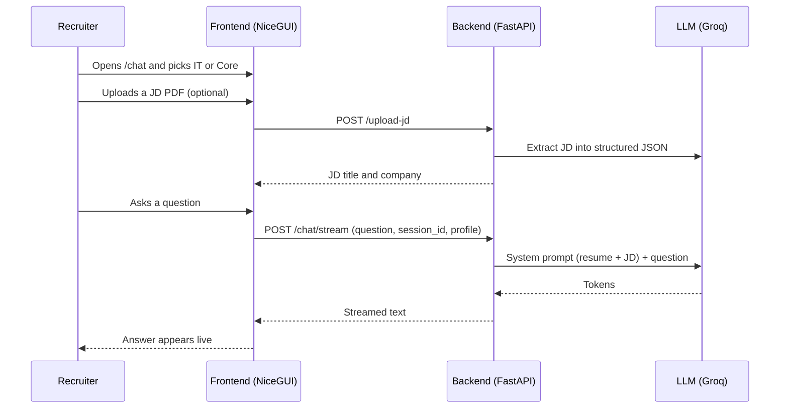

# AI Portfolio Website

A modern, fully responsive developer portfolio with a built-in **AI assistant**. Recruiters can chat with the assistant to learn about the candidate, upload a **job description (JD)** as a PDF, and get answers that match the candidate's resume against that role.

The whole stack is written in **Python**: a **NiceGUI** frontend and a **FastAPI** backend powered by an LLM served through **Groq**.

---

## Table of Contents

1. [Features](#features)
2. [How It Works](#how-it-works)
3. [Tech Stack](#tech-stack)
4. [Project Structure](#project-structure)
5. [Getting Started](#getting-started)
6. [Configuration](#configuration)
7. [API Reference](#api-reference)
8. [Design and Performance Notes](#design-and-performance-notes)
9. [Security and Privacy](#security-and-privacy)
10. [Troubleshooting](#troubleshooting)
11. [Limitations and Roadmap](#limitations-and-roadmap)
12. [Author](#author)

---

## Features

### Portfolio website

- Full-width, responsive layout for desktop, tablet and phone
- Purple, black and white palette with a **dark / light mode toggle** (the choice is remembered in the browser)
- Sections: Hero, About, Skills, Projects, Contact
- Every project card links straight to its **GitHub repository**
- **Live India (IST) clock** in the navigation bar, correct for every visitor regardless of their location
- **Visitor counter** next to the project count (counted once per browser per day, so refreshing does not inflate it)
- Smooth scrolling, scroll-reveal animations and reduced-motion support
- All personal content lives in one file (`site_content.py`), separate from the design code

### AI assistant ("Ask Anything")

- **Company-type selection:** the chat first asks whether the recruiter's company is **IT / Software** or **Core / Mechanical**, then answers from the matching resume
- **Two resumes:** one per profile, each parsed into structured data once and cached
- **JD upload and matching:** the recruiter attaches a JD as a PDF; the backend extracts its requirements and the assistant compares them with the resume, naming the matched skills and the honest gaps
- **Live streaming answers:** replies appear word by word, like a modern chat app
- **Grounded answers:** the assistant answers only from the resume and the JD, and says so when it does not have enough information

---

## How It Works



1. **Resume parsing.** On the first question for a profile, the backend reads the matching resume PDF, asks the LLM to turn it into a structured object, and caches it. Later questions reuse the cache.
2. **JD parsing.** An uploaded JD is read in memory, converted to structured JSON (title, company, required and preferred skills, experience, responsibilities, education), and stored against the chat session. The PDF itself is never saved.
3. **Answering.** The resume (and the JD, if present) goes into the system prompt together with rules that forbid inventing facts. The reply is streamed back to the browser.

---

## Tech Stack

| Layer | Technology |
|---|---|
| Frontend | [NiceGUI](https://nicegui.io) (Python), custom CSS, `httpx` |
| Backend | [FastAPI](https://fastapi.tiangolo.com), Uvicorn, Pydantic |
| LLM | [Groq](https://groq.com) API, model `openai/gpt-oss-120b` |
| PDF reading | `pypdf` |
| Package management | `uv` (backend), `pip` (frontend) |
| Python | 3.11 or newer |

---

## Project Structure

```text
My AI Portfolio Website/
├── Backend/
│   ├── main.py            # FastAPI app: resume + JD parsing, chat, streaming
│   ├── pyproject.toml     # Backend dependencies (managed with uv)
│   ├── uv.lock
│   ├── .env               # Secrets (NOT committed, see Security)
│   ├── resume_it.pdf      # Resume shown to IT / Software recruiters
│   └── resume_core.pdf    # Resume shown to Core / Mechanical recruiters
├── Frontend/
│   ├── main.py            # NiceGUI pages: homepage, chat, theme, styling
│   ├── site_content.py    # Your name, about, skills, projects, contact
│   ├── requirements.txt   # Frontend dependencies
│   └── visits.json        # Visitor counter (created automatically)
├── .gitignore
└── README.md
```

---

## Getting Started

### Prerequisites

- Python **3.11+**
- [`uv`](https://docs.astral.sh/uv/) (install with `pip install uv`)
- A free [Groq API key](https://console.groq.com/keys)
- Your two resumes as PDF files

### 1. Clone the repository

```bash
git clone https://github.com/aditya-ds-py/My-AI-Portfolio-Website.git
cd My-AI-Portfolio-Website
```

### 2. Set up the backend

```bash
cd Backend
uv sync
```

Create `Backend/.env`:

```env
GROQ_API_KEY=your_groq_api_key_here
```

Place your resumes in the `Backend` folder, next to `main.py`:

| File | Shown when the recruiter chooses |
|---|---|
| `resume_it.pdf` | IT / Software |
| `resume_core.pdf` | Core / Mechanical |

Start the backend:

```bash
uv run uvicorn main:app --port 8000
```

Open <http://127.0.0.1:8000/docs> to see the interactive API documentation.

### 3. Set up the frontend

Open a **second terminal** (keep the backend running):

```bash
cd Frontend

# create and activate a virtual environment
python -m venv .venv
# Windows (PowerShell):
.\.venv\Scripts\Activate.ps1
# macOS / Linux:
source .venv/bin/activate

pip install -r requirements.txt
python main.py
```

Open <http://localhost:8080>.

> **Tip (Windows):** if your terminal auto-activates another virtual environment, run the frontend with its own interpreter instead: `.\.venv\Scripts\python.exe main.py`

---

## Configuration

### Personal content

Edit **`Frontend/site_content.py`** only. It holds your name, role, tagline, about text, skills, projects, contact details and the suggested chat questions. Replace the placeholder values, and point each project's `url` at the real GitHub repository.

```python
GITHUB = "https://github.com/your-username"

PROFILE = {
    "name": "Your Name",
    "projects": [
        {"icon": "storefront", "url": f"{GITHUB}/your-repo", "title": "...", "desc": "...", "tags": ["..."]},
    ],
    # ...
}
```

Contact entries of type email, phone and GitHub become clickable links automatically.

### Environment variables

| Variable | Used by | Default | Purpose |
|---|---|---|---|
| `GROQ_API_KEY` | Backend | none (required) | Authenticates requests to Groq |
| `BACKEND_URL` | Frontend | `http://127.0.0.1:8000` | Where the frontend finds the backend |
| `STORAGE_SECRET` | Frontend | built-in value | Signs the browser cookie used for the visitor counter. Set your own value in production |

### Backend settings (`Backend/main.py`)

| Setting | Purpose |
|---|---|
| `RESUME_FILES` | File names of the two resumes |
| `PROFILE_LABELS` | Display names of the two profiles |
| `DEFAULT_PROFILE` | Profile used when a request does not specify one |
| `model` | LLM used for parsing and answering |
| `MAX_JD_BYTES`, `MAX_JD_CHARS` | Upload size and text limits for a JD |

---

## API Reference

Base URL: `http://127.0.0.1:8000`

| Method | Endpoint | Description |
|---|---|---|
| `GET` | `/` | Health check |
| `POST` | `/chat` | Returns the complete answer as JSON |
| `POST` | `/chat/stream` | Streams the answer as plain text while it is generated |
| `POST` | `/upload-jd` | Uploads and parses a job description PDF |
| `DELETE` | `/jd/{session_id}` | Removes the JD stored for a chat session |

### `POST /chat` and `POST /chat/stream`

Request body:

```json
{
  "question": "Am I a good fit for this role?",
  "session_id": "b6f1c0d2a7e34f0e9d55a1c2f0e8a9b1",
  "profile": "it"
}
```

- `question` (required): the recruiter's question
- `session_id` (optional): links the request to an uploaded JD
- `profile` (optional): `"it"` or `"core"`; falls back to `DEFAULT_PROFILE`

`/chat` responds with `{"answer": "..."}`. `/chat/stream` responds with a `text/plain` stream.

### `POST /upload-jd`

Multipart form data:

| Field | Type | Notes |
|---|---|---|
| `session_id` | text | Identifies the chat session |
| `file` | PDF | Maximum 5 MB, must contain selectable text |

Response: `{"title": "Senior Python Developer", "company": "Acme"}`

| Status | Meaning |
|---|---|
| `400` | The file is not a readable PDF |
| `413` | The file is larger than 5 MB |
| `422` | The PDF contains no text (for example a scanned image) |
| `502` | The LLM could not analyse the JD, try again |

---

## Design and Performance Notes

- **Smooth scrolling by design.** The page avoids expensive effects such as live backdrop blur on many elements and large blur filters. Decorative animation uses only `transform` and `opacity`, so it runs on the GPU. In testing, scrolling stays at the display's full refresh rate.
- **No wasted LLM calls.** Each resume is parsed once per server run and cached.
- **Responsive typography and layout.** Sizes use `clamp()`, and the grid collapses to a single column on small screens.
- **Accessible controls.** Icon-only buttons carry labels, focus outlines are visible, and animations respect the `prefers-reduced-motion` setting.
- **Theme without a flash.** The saved theme is applied before the first paint.

---

## Security and Privacy

- **Never commit `.env`.** It contains your API key. The repository's `.gitignore` excludes it, and GitHub push protection will block a push that contains a recognised key.
- **JD files are never stored.** The PDF is read in memory, converted to structured data and discarded. Only the structured result is kept in server memory, per chat session, until it is removed or the server restarts.
- **Prompt-injection hygiene.** Text from uploaded PDFs is treated strictly as data to extract from, not as instructions.
- **Private repository recommended.** The resume PDFs contain personal contact details. Keep the repository private, or add `Backend/*.pdf` to `.gitignore` and provide the files at deployment time.
- **Rotate keys** if one is ever exposed.

Recommended `.gitignore`:

```gitignore
.env
.venv/
__pycache__/
visits.json
```

---

## Troubleshooting

| Problem | Likely cause and fix |
|---|---|
| Chat shows "assistant is not reachable" | The backend is not running, or `BACKEND_URL` is wrong. Start the backend and check the port |
| `500` error on `/chat` | A resume file is missing or misnamed. Check `resume_it.pdf` and `resume_core.pdf` in `Backend/`. On Windows, make sure file extensions are visible so the name is not `resume_it.pdf.pdf` |
| `ModuleNotFoundError: No module named 'nicegui'` | The wrong virtual environment is active. Use the frontend's own `.venv` (see the tip above) |
| `uv trampoline failed to canonicalize script path` | The `.venv` was moved or renamed. Run `uv run python -m uvicorn main:app --port 8000`, or delete `.venv` and run `uv sync` |
| `Form data requires "python-multipart"` | Run `uv add python-multipart` in `Backend/` |
| `ImportError` mentioning `pydantic_core` | Mismatched package versions. Run `pip install --force-reinstall pydantic pydantic-core` in that environment |
| Port already in use | Close the old process, or start on another port and set `BACKEND_URL` to match |
| JD upload says "No text found" | The PDF is a scan. Use a text-based PDF |
| Icons show as plain words | Use a valid Material Icons name in `site_content.py` (for example `insights`, not `monitoring`) |

---

## Limitations and Roadmap

**Current limitations**

- JD data and parsed resumes are kept in memory, so they reset when the backend restarts and are not shared between multiple server processes.
- The visitor counter is stored in a local file. On hosts with temporary disks it may reset after a restart.
- Scanned (image-only) PDFs are not supported because there is no OCR.
- Conversation history is not sent to the model, so each question is answered independently.

**Ideas for the future**

- Conversation memory for follow-up questions
- OCR for scanned PDFs
- Database-backed visitor counter and session storage for deployment
- Saving and emailing a chat summary to the candidate
- Rate limiting on the chat endpoints

---

## Author

**Aditya Sharma** — Full-Stack Developer

GitHub: [aditya-ds-py](https://github.com/aditya-ds-py)
